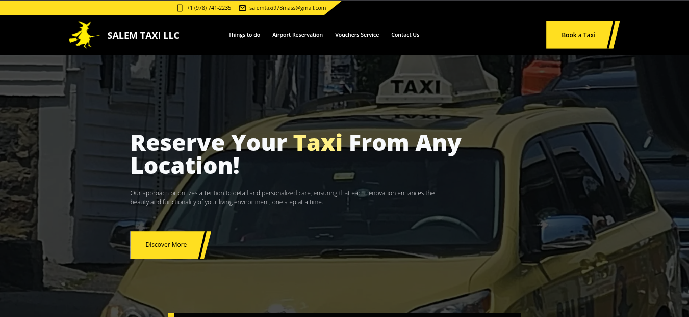

# Landing Page · Taxi Service in Salem

Professional landing page developed for a client in the **transportation (taxi)** sector in **Salem**, designed to showcase their services, build trust, and make it easy for users to request a ride quickly.

🔗 **Live site:** [Salem Taxi LLC](https://www.salem-taxi.com)



## Features
- Responsive design
- Click-to-call button
- Booking forms
- Direct contact: phone number and email
- Services section: airport transfers, local rides, and more

## Installation
```bash
git clone https://github.com/JordiCode/salem-taxi-website.git

cd salem-taxi-website

npm install

npm run dev
```

## 🛠️ Stack

- [![Astro][astro-badge]][astro-url] - The web framework for content-driven websites.
- [![Tailwind CSS][tailwind-badge]][tailwind-url] - A utility-first CSS framework for rapidly building custom designs.

[astro-url]: https://astro.build/
[typescript-url]: https://www.typescriptlang.org/
[tailwind-url]: https://tailwindcss.com/
[astro-badge]: https://img.shields.io/badge/Astro-fff?style=for-the-badge&logo=astro&logoColor=bd303a&color=352563
[typescript-badge]: https://img.shields.io/badge/Typescript-007ACC?style=for-the-badge&logo=typescript&logoColor=white&color=blue
[tailwind-badge]: https://img.shields.io/badge/Tailwind-ffffff?style=for-the-badge&logo=tailwindcss&logoColor=38bdf8
